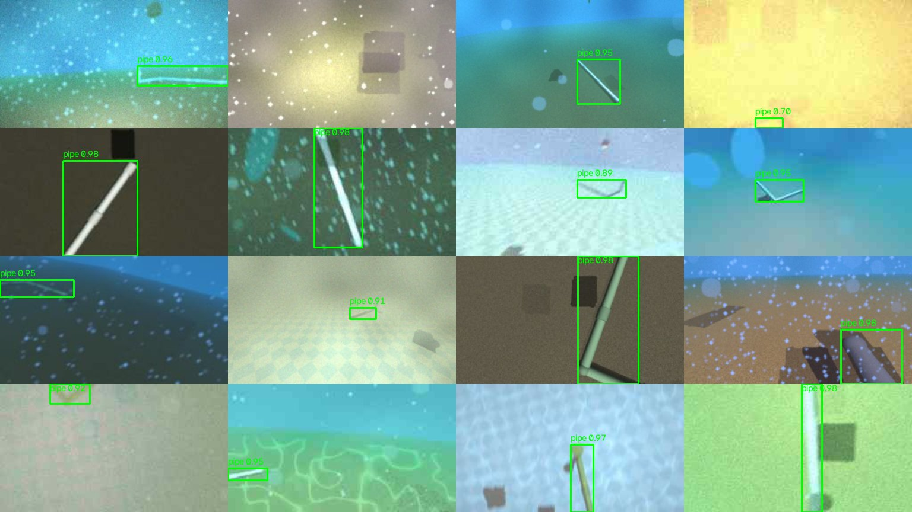

# Pipe detector

Finds the PVC pipe in an ROV camera frame and returns a bounding box, so the
ROV can steer toward it. It is trained only on frames rendered from this
repo's MuJoCo simulation, with the underwater look (murky water, colour
loss, marine snow, low light, blur, sensor noise…) added on top.



*Held-out test frames (never used in training), with the model's boxes.*

## Using it

```python
import cv_processor as cvp

det = cvp.detect_pipe(frame_rgb)   # also shows the frame with the box in an OpenCV window
if det is not None:
    x0, y0, x1, y1 = det["box"]    # pixels in frame_rgb
    cx, cy = det["center"]         # box centre in [-1, 1]; +x right, +y down
    det["size"], det["score"]      # box area as a fraction of the frame, confidence 0..1
```

Or `from pipe_detector.detector import PipeDetector` to use it without the
display. Running it needs only OpenCV and numpy: the network ships as
`pipe_net.onnx` (3.4 MB) and runs through `cv2.dnn`, at about 50 ms per
frame on a CPU. It accepts frames of any size.

## Results

The shipped `pipe_net.onnx`, scored on splits that training and model
selection never touched:

| Test set | Accuracy | Recall | False alarms | Box IoU |
|---|---|---|---|---|
| Your sim scene (`models/rov.xml`), as rendered | **93.9%** | 93.8% | 5.8% | 0.89 |
| Randomised scenes, no water effects | **94.6%** | 93.7% | 0.6% | 0.89 |
| Randomised scenes, underwater | **88.0%** | 86.2% | 4.0% | 0.81 |
| Your sim scene + underwater | **86.5%** | 85.0% | 5.3% | 0.80 |

How these are measured:

- **Accuracy:** share of frames handled correctly. Either there is no pipe
  and nothing is reported, or there is one and the box overlaps the true box
  with IoU ≥ 0.5.
- **Recall:** share of frames with a visible pipe where it was found with IoU ≥ 0.5.
- **False alarms:** share of frames without a pipe where a box was reported anyway.
- **Box IoU:** mean overlap between the predicted and true boxes, counting a miss as 0.
- **Visible:** a pipe counts as visible only if it stands out from its
  surroundings by more than the noise in the final image. Frames where the
  only pipe is too faint to tell either way (4–7% of the underwater frames)
  are left out.
- **Steering accuracy:** when the box is right, its centre is within 4.4% of
  the frame width of the true centre in 90% of cases (2.1% without water).

**Overfitting check.** Every epoch, a fixed set of 2,000 training frames is
scored the same way as validation. The two never separated: the final
epoch scored 90.0% on validation and 88.8% on the training frames. The
test-set scores above are in line with validation.

The full numbers are in `runs/` when you train (not committed).

## How it works

```
generate.py      render frames from the sim; labels come from MuJoCo's segmentation
underwater.py    add water, light, particles and camera effects; decide which pipe is still visible
model.py         PipeNet: small encoder-decoder (840k params) that marks pipe pixels
detector.py      mask -> bounding box (runtime, OpenCV only)
train.py         training, validation, ONNX export, test scoring
navigate.py      ApproachPipe steering behaviour + a closed-loop test in the sim
scene.xml        models/rov.xml plus rocks, blocks, weed and a larger seabed
```

- **Scene variation.** Each frame comes from a different randomised version
  of the sim scene: the pipe's pose, which pieces exist (a straight run, an
  L, the full run with the riser), its colour (white, grey or fouled PVC),
  the seabed (pool tile, sand, mud or silt), the lighting, the camera's
  field of view and the ROV's pose. Rocks, blocks and thin weed stalks act
  as things that are *not* pipe.
- **Mask first, then the box.** The network predicts which pixels are pipe,
  and the box is drawn around them. Learning per pixel gives far more
  training signal than predicting four box numbers, which is a large part of
  why it does not overfit. A stray blob much weaker than the main pipe is
  dropped, so it cannot stretch the box.
- **Water physics.** The underwater look follows the standard model of how
  light travels through water. Each colour fades with distance at its own
  rate (red first), and scattered light from the water itself adds haze.
  Distances come from the sim's depth render, so far things fade correctly.

### Underwater conditions covered

- **Water:** clear blue, green coastal, turbid brown and pool water, each
  with random murkiness, plus patchy sediment clouds.
- **Light:** dim to bright ambient light, the ROV's own spotlight with its
  fall-off, and shallow-water caustics.
- **Particles and blockers:** marine snow (sharp specks and out-of-focus
  blobs), and fish or weed passing in front of the camera.
- **The pipe and its surroundings:** pipes fouled with algae or sediment,
  white debris and thin weed or rope that look pipe-like, and the sim's own
  floor edge and tile patterns.
- **The camera:** defocus and motion blur, auto-exposure, white-balance
  drift, gamma, sensor noise (worse in low light), vignetting and JPEG
  compression. The sim streams JPEGs.
- **Clear frames:** 15% of frames are left without water, so a crisp frame
  is never unfamiliar.

## Training it yourself

Run these from the repo root inside `.venv`. Training also needs `torch` and
`onnx`, which are listed in `requirements.txt`.

```bash
python -m pipe_detector.generate                    # renders 25k frames into pipe_detector/data (~10 min, 4.3 GB)
python -m pipe_detector.train                       # ~5.5 min/epoch on CPU; writes pipe_net.onnx
python -m pipe_detector.train --resume              # continue after stopping it
python -m pipe_detector.train --eval                # score pipe_net.onnx on the test splits
python -m pipe_detector.navigate --episodes 20      # closed-loop: does steering by the box reach the pipe?
```

The shipped model was produced in two steps. It was first trained for 30
epochs from scratch (v3 below), then fine-tuned with
`--init runs/best.pt --lr 1e-3` on data from the current `generate.py` for
10 epochs (v4).

## Iteration log

| Version | Change | Validation accuracy |
|---|---|---|
| v1 | first model (421k params) | stopped early: labels claimed pipe that fog had hidden |
| v2 | pipe labelled only where its contrast beats the noise; stray blobs no longer stretch the box | 71.5% (stopped early, epoch 5) |
| v3 | wider network (840k params); larger seabed, because the 10 m seabed's edge was being learned as "pipe" | 87.1% |
| v4 | fine-tuned with 15% clear frames and some of the sim's own seabed (its edge and tile moiré) | **90.0%** |

The v3 → v4 step cut false alarms on your sim scene from 13% to 5.8%.

## Limitations and next steps

- **Simulation only so far.** It has not seen real camera footage. Fine-tune
  on real frames from your camera before relying on it in water.
- **Thin rods are its main confusion.** A weed stalk or rope can look like a
  distant pipe. Large, dark, elongated blobs (fish passing close to the lens)
  occasionally do too.
- **One box around all visible pipe.** If the run shows up as two separate
  pieces, they still get a single box.
- **Navigation is not re-measured.** The last closed-loop result (v3 model)
  reached the pipe in 11 of 20 episodes. Most failures stopped short because
  a single frame was falsely detected below the ROV, and two never saw the
  pipe in very murky water. Since then, arrival needs five steady
  down-camera frames, and fish no longer stay frozen across a test episode.
  Re-run `navigate.py` to get the current number.
